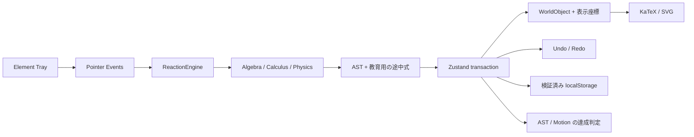

# Math Elements Architecture

## 責務の分離

```text
src/
  ast/          AST の型、生成、検証、LaTeX 表示への変換
  algebra/      厳密有理数、評価、簡約、分解、線形項の解析
  calculus/     依存変数の判定、微分、原始関数の規則
  engine/       ReactionEngine、反応ルール、学習用途中式
  physics/      物体の条件、解析的運動、ベクトル・行列演算
  store/        Zustand、シーン、履歴、保存の入出力
  challenges/   初期条件、使える要素、AST ベースの達成条件
  components/   ワークスペース、Pointer 操作、表示、選択パネル
  utils/        座標配置、ID、Web Audio
  styles/       モノクロのレスポンシブ UI
e2e/            実ブラウザでの操作・描画テスト
```



## 数学の意味を保持する AST

`Expression` は `kind` で判別する union です。数・変数・定数・演算子に加え、Add / Subtract / Multiply / Divide / Power / Root / Equation / Function / Derivative / Integral / Vector / Matrix / PhysicsQuantity を持ちます。

例えば `2x + 3 = 7` は次の構造です。

```text
Equation
  left: Add
    Multiply
      Number(2)
      Variable(x)
    Number(3)
  right: Number(7)
```

`WorldObject` が `id`、`node`、`x`、`y` と物体の条件・表示用の合成ベクトル履歴を持ちます。数学の木には座標、選択状態、React のキーを入れません。LaTeX は `toLatex()` で生成する表示形式であり、評価・保存・チャレンジ判定の入力にはしません。

入力途中の二項演算子は `OperatorNode.left` で最初のオペランドを保持します。`2 + □` は文字列パーサーを通さず、次のオペランドを受け取って AddNode に変わります。

## 反応のライフサイクル

1. UI が `canCombine(target.node, incoming.node, context)` に問い合わせる。
2. 対応するルールがあり、定義域に既知の問題がない相手だけに吸着を表示する。
3. ドロップ時に `combine()` が `ReactionResult` を返す。無効な反応は `null` となり、元の AST を変更しない。
4. 一回の `commit()` で消費する入力と結果を置き換え、Undo 用に直前のシーンを保存する。
5. `intermediate` があれば約 1 秒表示してから結果を見せる。表示の移行自体は 150–260 ms。分数の通分や両辺操作の読み取り時間をアニメーション時間と分ける。

永続化する木は確定済みの結果です。途中式は別の `transitions` にあるため、アニメーション中の再読込や Undo で式を失いません。タイマーにトークンを持たせ、取消後の古いタイマーが新しい状態を書き換えることを防ぎます。

`ReactionEngine.register(rule)` にルールを追加すると反応を拡張できます。UI に演算子同士の組み合わせ判定を追加する必要はありません。数学以外の物理量の適用も独立した反応ルールで判定します。

## 数値と定義域

- 整数・有限小数を BigInt の分子・分母へ変換し、GCD / LCM による厳密算術を実行します。保存する AST は JSON 互換です。
- 安全な整数に戻せない結果は無理に丸めず、記号式を保持します。
- `evaluate()` は木を再帰的に評価します。未指定の変数は `null`、既知の定義域エラーは `MathDomainError` です。NaN / Infinity を UI に渡しません。
- π / e を記号として残します。一般の関数の評価を近似値と勝手に置き換えません。
- `x/x` のように変数の定義域を狭める約分は保持します。方程式の掛け算・割り算は、ゼロでないことが分かるスカラーに限定し、同値性を保ちます。
- 微分は再帰的な規則、積分は対応する原始関数を探索する規則です。対応できない形を推測で簡約しません。

## 座標と操作

ワークスペースの論理座標は、その DOM 要素の左上を原点とする CSS pixel です。毎回 `clientX/Y - getBoundingClientRect().left/top` で変換します。記号は論理座標を中心として表示し、ドラッグ開始時の pointer offset を最後まで保持します。要素の CSS transform を論理座標へ逆算する処理はありません。

ドラッグ中はローカルなプレビューを更新し、ドロップ時にだけ履歴を追加します。Pointer capture と window のイベントで、要素外への移動に追従します。pointercancel・Escape・ウィンドウのフォーカス喪失はコミットせず取消します。無効なドロップは空き位置へ配置し、通常の記号同士が重ならない位置を探索します。

ベクトルの `x/y` は数学の成分であり、オブジェクトの `x/y` は始点です。SVG に渡す段階で上向きの数学 y を反転します。行列の表示変換も同じ符号変換を適用し、数学的に反時計回りの回転が画面でも一致します。

## シミュレーション

物体の質量、初速、角度、重力、外力を保存し、実行中の時間は UI のフックで管理します。追加の物理効果がない場合は従来の一定加速度の解析解を使います。

床の相対座標を計算して飛行時間の正の根を求めます。床上での下向きの加速度は支持力で相殺し、水平運動には摩擦を加えません。空中からの着地では位置を交点に固定し、衝突直前の速度を読み出せます。軌跡のサンプル数は最大180点として描画量を抑えます。

摩擦・抵抗・揚力・浮力・反発を有効にすると固定刻み 1/240 秒の計算に切り替わります。外力による速度変更、相対速度の二乗に比例する抵抗の減衰、揚力による相対速度ベクトルの回転、床の摩擦・反発を順に適用します。揚力だけでは相対運動の速さを増やしません。流体密度と水中体積は一定です。着地後の滑走に対応し、床上で静止するまでシミュレーションを続けます。

`WeakMap<BodyConfig, trajectory>` に固定刻みの結果を保存し、軌跡描画とアニメーションで共有します。BodyConfig はストアで不変更新されます。最大実行時間は 120 秒です。追加パラメータは省略可能で、従来の保存データをそのまま読み込めます。

## 配置操作

左のアイテム欄とワークスペースは横並びの flex layout です。Pointer Events の座標はワークスペースの矩形を基準に変換します。移動モードまたは Alt ドラッグは合成判定を省略し、指定位置に移動します。新規配置と複製では空き位置を探します。

`WorldObject.rotation` は表示の回転角です。CSS の独立した translate / rotate を用い、回転でオブジェクトの中心がずれないようにしています。ベクトルは表示角を回す代わりに成分を回転し、方向を持つ物理量は angle を更新します。物体の見た目の回転は初速と独立しており、角運動量やトルクは扱いません。配置・複製・回転は Scene の更新として Undo / Redo と保存に対応します。

チャレンジ10は指定の初速・角度・重力と、実際の着地点が目標範囲に入ったことを確認します。時間の経過だけで正解にする処理はありません。

## 保存と履歴

Math と Physics の Sandbox は別シーンです。Challenges のシーンは Sandbox を上書きしません。履歴は最大80シーンで、確定した反応・移動・編集単位に保存します。チャレンジの達成履歴は Undo しても保持します。

永続化はバージョン付きの JSON です。読み込み時に AST の深さ・配列長・数値・識別子・物体条件を検証します。無効なシーンは初期化し、有効な設定と達成履歴は復元します。容量制限や localStorage の無効化は捕捉し、ワークスペース上に保存状態を表示します。

## 拡張時の手順

1. 必要なら新しいノードを `ast/types.ts` に定義し、入力検証と `toLatex()` を追加する。
2. 数学的規則を algebra / calculus / physics に実装し、定義域を含むテストを追加する。
3. ReactionRule を登録し、必要な場合は途中式を返す。
4. トレイに生成用の要素を追加する。特殊な視覚表現が必要なときだけ描画コンポーネントを追加する。
5. 保存互換性が変わる場合はバージョンと移行処理を更新する。

テストは実装の複写ではなく、入力の保持、演算結果、同値な方程式操作、取消と履歴、実際の Pointer 操作など、利用者に見える性質を検証します。
